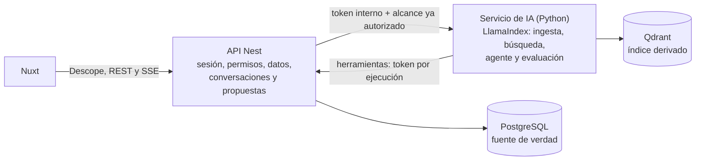

# 01 — Visor del feed y E6: IA con LlamaIndex (Python) y Qdrant

Fecha de creación: 2026-11-09  
Última actualización: 2026-11-13
Estado: En curso. V1, E6.0, E6.1a (2026-11-09) y E6.1b.1 (2026-11-12) hechas y verificadas; E6.3b verificada en FastAPI con el contrato de Nest simulado. Quedan E6.1b.2, E6.2, E6.3a, la integración de E6.3 y E6.4–E6.7. El orden de lo que falta, junto con hojas y la extensión del visor, está en el [plan 02 de cierre](../cierre-backend/02-plan-terminar-hojas-visor-y-agente.md).
Ámbito: la API Nest (`LearningAllPosibolIt`) y el servicio de IA nuevo (`LearningAllPosibolIt-ai`), hasta el límite con E7 (la web Nuxt la lleva otra sesión).  
Relacionada con: [fuentes 01](../../../fonts/feature/ai-assistant/01-fuentes-del-visor-qdrant-y-llamaindex.md), [revisión 02 de LlamaIndex](../../../fonts/feature/ai-assistant/02-revision-de-llamaindex-para-la-api.md), [plan del servicio de IA](../../../../../LearningAllPosibolIt-ai/docs/plans/feature/base-del-servicio/01-plan-servicio-de-ia.md), [ampliación de la visión](../../../../../docs-diagrams/fuentes/2026-11-09-ampliacion-visor-qdrant-llamaindex.md), [15](../../../../../docs-diagrams/15-chat-ia-herramientas-y-propuestas.md), [16](../../../../../docs-diagrams/16-nuxt-tabla-central-chat-y-contratos.md), [18](../../../../../docs-diagrams/18-secuencia-de-entregas-y-matriz-de-aceptacion.md).  
Revisión de referencia: `feature/cierre-backend` `b219b30`.

*Ajustado el 2026-11-09, el mismo día:* la primera versión de este plan usaba LlamaIndex.TS dentro de Nest. La [revisión 02](../../../fonts/feature/ai-assistant/02-revision-de-llamaindex-para-la-api.md) mostró que está abandonado y el usuario eligió **LlamaIndex en Python como servicio aparte**, con arquitectura limpia como `HANDLE-BUSINESS/backend` y dentro de este mismo espacio de trabajo.

## Objetivo

1. Que la web pueda enseñar, como un Merchant Center propio, los productos exactos del TSV y de cada versión del feed.
2. Un agente en la web, hecho con LlamaIndex sobre Qdrant, que conoce todo lo que la persona puede ver (hojas, importaciones, catálogo, reglas, evaluaciones, exportaciones y feed), responde con esos datos y prepara acciones. Aprobar, aplicar y publicar siguen siendo un clic humano.

## Reparto: Nest es la puerta, Python es el cerebro

- **Nest** sigue siendo la única API pública: sesión Descope, permisos por organización (C6), datos, conversaciones, ejecuciones, propuestas (changesets) y eventos para la web.
- **El servicio de IA** no tiene base de datos propia ni lee PostgreSQL. Recibe de Nest documentos ya autorizados para indexar y, al ejecutar el agente, un **alcance** (organización, proyectos visibles, quién actúa). Sus herramientas vuelven a Nest, que comprueba los permisos otra vez.
- **Qdrant** solo lo usa el servicio de IA. Es un índice derivado: se puede borrar y reconstruir desde PostgreSQL.

## Decisiones

| ID | Decisión | Respaldo |
| --- | --- | --- |
| D1 | **Visor:** `GET /projects/:projectId/exports/:exportId/products` y `GET /projects/:projectId/feeds/:feedId/versions/:versionId/products`, con `limit`, `offset` y `search` (texto en `id` o `title`). Leen el **archivo** TSV, no la base: es exactamente lo que recibe el canal, también si la importación de origen ya se borró. Respuesta `{ columns, products: [{ line, values }], rowCount, page }`. Se lee línea a línea y se deja de leer al llenar la página. El diagnóstico (inválidos y excluidos) sigue saliendo de `GET …/evaluations/:id/rows`, que ya existe. Una versión cuyo archivo retiró la retención responde 410. | Ficha 01: E1–E5, H1 |
| D2 | **Servicio de IA en Python 3.12** con `uv`, FastAPI y LlamaIndex (`llama-index-core` 0.14.x), en la carpeta hermana `LearningAllPosibolIt-ai` con su propio git. Arquitectura por capas como `HANDLE-BUSINESS/backend` (dominio, aplicación con puertos `in_`/`out_` y casos de uso, infraestructura, HTTP, configuración, arranque y común), con las dependencias comprobadas por `import-linter`. Detalle en su [plan](../../../../../LearningAllPosibolIt-ai/docs/plans/feature/base-del-servicio/01-plan-servicio-de-ia.md). | Revisión 02, decisión del usuario |
| D3 | **Qdrant de desarrollo** del servicio de IA: contenedor `estadistica-forms-qdrant` de la imagen local `qdrant/qdrant:v1.19.1`, 2 CPU, 1 GiB, solo en `127.0.0.1:56333`, volumen `estadistica-forms-qdrant-data`. El `backend-qdrant` de otro proyecto no se toca. Cliente Python `qdrant-client` de la misma versión menor (1.19). | Ficha 01: E7, E8, M1 |
| D4 | **Una colección para todas las organizaciones**, con índice `organization_id` (`keyword`, `is_tenant: true`) y además `project_id`, `source_type` y `source_id`. El servicio de IA añade **siempre** el filtro de organización y proyectos visibles que recibe de Nest; el modelo o el texto de la pregunta no lo pueden cambiar. | Ficha 01: F1; H5 |
| D5 | **Modelos de la API de Google, ninguno propio ni descargado** (usuario, 2026-11-09). Embeddings con **Vertex AI `gemini-embedding-001`** reducido a 768 dimensiones, con tipo de tarea `RETRIEVAL_DOCUMENT` al indexar y `RETRIEVAL_QUERY` al preguntar, por `llama-index-embeddings-google-genai`. Acceso por IAM: credenciales de la cuenta (ADC) en local y cuenta de servicio en Cloud Run, sin claves de API. Búsqueda **solo por significado** en Qdrant; lo exacto (SKU, precios, recuentos) por herramientas sobre SQL; la búsqueda por palabras dentro de Qdrant (BM25 del servidor) llegará al subir a Qdrant 1.20. Los textos que se indexan salen hacia Vertex AI en el proyecto `estadistica-forms-api`. *Ajustado el 2026-11-09:* sustituye a FastEmbed local, descartado por el usuario. | Ficha 03; usuario |
| D6 | **Comunicación interna:** Nest → IA con un token de servicio en cabecera (comparación en tiempo constante; en Cloud Run, identidad de servicio) y el alcance en el cuerpo. IA → Nest, solo para herramientas, con un token por ejecución que caduca y que Nest liga a la persona y al alcance. El servicio de IA escucha solo en `127.0.0.1`. | 15, H5 |
| D7 | **Indexar después del commit** por el outbox de Nest: Nest decide el texto y los metadatos de cada documento (fila de hoja, producto del catálogo, problema de evaluación, estado del feed) y el servicio de IA trocea, calcula embeddings y guarda (`IngestionPipeline` con estrategia *upsert* por hash). Borrar un proyecto retira sus puntos. Si el servicio de IA o Qdrant no responden, la API sigue funcionando y `health` lo dice. | 13, 15; curso LlamaIndex 17 y 19 |
| D8 | **Conversaciones, ejecuciones y eventos viven en Nest** (tablas de 15). El servicio de IA no guarda estado: recibe el historial, devuelve eventos en streaming y Nest los persiste antes de reenviarlos por SSE. | 15; curso Angular/Nest 134–138 |
| D9 | **La IA maneja casi toda la API (≈90 %)** (petición del usuario, 2026-11-09). En Nest, un **catálogo de operaciones para la IA**: cada operación se declara una vez junto a su módulo, con nombre estable, descripción, esquema de entrada (del mismo DTO que valida REST), permiso de organización y **nivel**: `read` (consultar), `write` (crear o cambiar borradores, importaciones, reglas, evaluaciones, feeds en preparación) o `forbidden`. Las operaciones elegidas en C7 se consumen por GraphQL. Una ruta interna del catálogo ejecuta las demás. Ambos contratos usan la identidad de la persona y los mismos servicios que REST, con 404 para un recurso ajeno y 403 si es visible pero falta permiso. Queda fuera (el ≈10 %): aprobar, aplicar, publicar, borrar, cambiar roles o miembros, tokens de entrega y lo que gaste dinero; ninguna operación se expone si no está declarada. | Usuario; 15; 8.3 de la visión |
| D12 | **Elegir herramientas por búsqueda.** Con más de cien operaciones, el agente recibe en cada ejecución solo las relevantes: LlamaIndex indexa las descripciones del catálogo (`ObjectIndex` sobre Qdrant, colección aparte) y recupera las de la pregunta, más un núcleo fijo (`search_knowledge`, `get_project_overview`). El catálogo que ve cada persona se filtra por sus permisos antes de buscar. | Revisión 02 (ObjectIndex); curso LlamaIndex 45 (límite de contexto y elección de herramienta) |
| D13 | **Confirmación humana de las escrituras.** Una operación `write` no se ejecuta en cuanto el modelo la pide: el agente emite «necesito confirmación» con lo que va a hacer (operación, objetivo, resumen de cambios) y espera; la web lo muestra y la persona confirma o rechaza con su sesión. Las lecturas se ejecutan directamente. Los cambios de datos oficiales siguen yendo por changesets con aprobación humana. | 15, 8.3 de la visión |
| D10 | **Modelo de lenguaje: Gemini por Vertex AI** (`llama-index-llms-google-genai`), elegido en E6.5 con evaluación (evaluadores Faithfulness/Relevancy/Correctness de LlamaIndex y el dataset de 15). Hasta entonces, el LLM simulado de LlamaIndex. | 15; usuario |
| D11 | **Cuidar el portátil**: un contenedor cada vez con límites, pruebas en serie y parar al terminar. Las pruebas normales usan embeddings deterministas de prueba; las que llaman a Vertex AI van marcadas aparte y solo corren a mano. | Memoria del usuario |

### Decisiones de E6.1b (añadidas el 2026-11-09)

| ID | Decisión | Respaldo |
| --- | --- | --- |
| D14 | **Módulo `knowledge` en Nest**, por encima de proyectos, catálogo, evaluaciones, reglas y feeds: lee sus tablas con su propio repositorio (como `exports` lee las de evaluaciones) y ninguno depende de él. Cliente `AiServiceClient` con `fetch`, `Authorization: Bearer <AI_SERVICE_TOKEN>`, `X-Request-Id` y plazo. Sin `AI_SERVICE_URL` el conocimiento está **desactivado**: el reconciliador no arranca y las rutas lo dicen. | Ficha 03; plan del servicio |
| D15 | **Reconciliador idempotente, sin bloqueo entre instancias.** Cada pasada (`WorkerLoop`, cada 30 s) calcula la huella de cada fuente con SQL, la compara con `knowledge_sync_state` y manda solo lo que cambió. Reemplazar una fuente es idempotente en el servicio de IA (por hash), así que dos instancias a la vez solo repiten trabajo, nunca lo estropean. La huella se guarda **solo** cuando el servicio confirmó: si cae, se reintenta en la pasada siguiente. Una fuente que ya no existe se borra del índice; un proyecto que ya no existe, entero. | Ficha 03 («Cómo llegan los cambios») |
| D16 | **`knowledge_sync_state`** (`project_id`, `source_type`, `source_id`, `organization_id`, `fingerprint`, `synced_at`), clave primaria por fuente y **sin clave foránea** a `projects`, para recordar qué borrar cuando el proyecto desaparece. | Ficha 03 |
| D17 | **Rutas:** `GET /projects/:projectId/knowledge` (cualquier miembro: activado o no, y cada fuente con su última sincronización y si está pendiente) y `POST /projects/:projectId/knowledge/reindex` (Manager o más, porque gasta llamadas a Google: borra el estado del proyecto para que la pasada siguiente lo mande entero; 202). | 15 (cuotas); C6 |
| D18 | **Textos en español y sin datos personales:** cada documento se escribe como lo leería una persona («Producto SKU-42 · Título … · Evaluación: inválido — falta la imagen»), con los problemas traducidos por `describeProblem`. Ni correos ni tokens ni claves de archivos. | Ficha 03 |

## Etapas

Cada etapa sigue el flujo de siempre en el repositorio que toca: bitácora «En curso» → «Implementado y verificado», pruebas, defectos a propósito y verificación completa.

1. ✅ **V1 — Visor del feed** (Nest; D1), [bitácora 01](../../../../bitacora-construccion/feature/ai-assistant/01-visor-del-feed.md). *Ajustado en V1:* `ExportDownload` lleva `rowCount`; prueba añadida de una versión ajena pedida desde el propio feed. Comprobación: E2E con exportación y versión publicada (columnas, valores, paginación, búsqueda, 404 ajeno, 410 retirado, 401) y unitarias del lector de TSV.
2. ✅ **E6.0 — Base del servicio de IA** (Python; D2, D3, D6, D11), [bitácora del servicio](../../../../../LearningAllPosibolIt-ai/bitacora-construccion/feature/base-del-servicio/01-base-del-servicio.md). *Ajustado en E6.0:* la comprobación de versión del cliente de Qdrant se hace en la salud del servicio (la del cliente es síncrona). Proyecto `uv` con las capas y sus contratos, configuración, Qdrant de desarrollo, conexión y estado, autenticación interna, errores, registro por petición y pruebas. Comprobación en su plan.
3. **E6.1 — Indexar el conocimiento** (D4, D5, D7), en dos partes. ✅ **E6.1a (Python)**, [bitácora](../../../../../LearningAllPosibolIt-ai/bitacora-construccion/feature/base-del-servicio/02-indexar-el-conocimiento.md): API interna para reemplazar los documentos de una fuente, borrar una fuente o un proyecto y buscar con el filtro de inquilino; colección con índices propios (`is_tenant`); embeddings de Google detrás de un puerto; solo se recalculan los documentos cuyo contenido cambió. **E6.1b (Nest)** en dos porciones: ✅ **E6.1b.1** (cerrada el 2026-11-12: 37 pruebas, 15 de 15 defectos y arranque real, [bitácora 02](../../../../bitacora-construccion/feature/ai-assistant/02-nest-manda-el-conocimiento.md)), base (cliente, `knowledge_sync_state`, reconciliador, rutas de estado y reindexar) con las fuentes del producto: `project`, `catalog` (una ficha por producto que junta catálogo, última evaluación y feed), `evaluation`, `ruleset` y `feed`; **E6.1b.2**, `worksheet` (esquema y filas de la revisión vigente), `workbook`, `changeset`, `worksheet_import` y `organization`. T18b.
4. **E6.2 — Conversaciones y mensajes** (Nest; D8). Tablas, rutas, privacidad por defecto, `clientMessageId` idempotente. Migración.
5. **E6.3 — Catálogo de operaciones y agente con LLM simulado** (los dos; D6, D9, D12, D13). Nest: el catálogo (empezando por las lecturas de todos los módulos y las escrituras de borradores e importaciones), el token por ejecución para el cliente GraphQL de C7 y la ruta interna del catálogo, las ejecuciones y las confirmaciones. Python: `FunctionAgent`, selección de herramientas por búsqueda y espera de confirmación. T18–T20 y una prueba que recorre el catálogo entero comprobando que ninguna operación prohibida está declarada.
   - **E6.3b (2026-11-13)**. FastAPI ya expone `POST /v1/agent/runs` con selección semántica en Qdrant. Nest deberá enviar el catálogo y la credencial efímera. Las lecturas llaman a Nest en modo `execute` y las escrituras en modo `prepare`, con confirmación posterior en Nest. [Contrato y plan](../../../../../LearningAllPosibolIt-ai/docs/plans/feature/agente/01-plan-agente-con-llm-simulado.md) · [Bitácora](../../../../../LearningAllPosibolIt-ai/bitacora-construccion/feature/agente/01-agente-con-llm-simulado.md).
6. **E6.4 — Eventos, cancelación y cuotas** (los dos). Streaming Python → Nest, SSE Nest → web con `after=<seq>`, cancelar y límites de 15. T21–T22.
7. **E6.5 — Modelo real con evaluación** (D10): Gemini por Vertex AI. Requiere que el usuario active Vertex AI en el proyecto.
8. **E6.6 — Endurecimiento, contrato para Nuxt y plan de despliegue** (Cloud Run con el servicio de IA privado).
9. **E6.7 — (opcional) Servidor MCP** con las mismas herramientas, si el usuario lo quiere.

## Comprobación prevista

Al cerrar E6.3 y E6.6: recorrido completo con dos organizaciones (importar → evaluar → exportar → publicar → preguntar al agente y ver una propuesta) y arranque real de los dos servicios, también con el de IA apagado.

## Límites

- La pantalla del visor y la del chat son de E7 (Nuxt); aquí solo las APIs y su contrato.
- Nada de esto cambia rutas existentes de Nest.
- No se suben datos reales a proveedores externos hasta E6.5 y con la política que decida el usuario.
- C7 se evalúa primero y se construye antes de retomar E6.1b.2. Para las herramientas seleccionadas se reutiliza el cliente GraphQL validado en C7. En E6.3, Nest aplica el mismo catálogo, identidad, alcance y token por ejecución a esas operaciones. La ruta interna del catálogo cubre las demás. Ver [23, plan C7](../../../../../docs-diagrams/23-graphql-nest-para-fastapi-y-nuxt.md).
