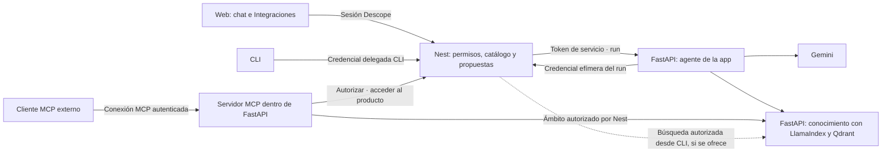

# 07 — Plan de acceso externo y CLI

Fecha de creación: 2026-11-14  
Última actualización: 2026-11-14  
Estado: Plan.  
Ámbito: Nest, contrato de Integraciones para Nuxt y cliente CLI. La adaptación MCP corresponde a E6.7.  
Relacionada con: [fuentes 09](../../../fonts/feature/ai-assistant/09-fuentes-de-acceso-externo-y-cli.md), [plan maestro](../cierre-backend/02-plan-terminar-hojas-visor-y-agente.md), [H6](04-plan-herramientas-de-hoja-del-agente.md), [E6.3a](05-plan-catalogo-ejecuciones-y-confirmaciones.md), [E6.6](06-plan-eventos-cuotas-y-contrato-del-chat.md).  
Revisión de partida: Nest `7be788b`, FastAPI `d9f00fd`, más el trabajo local de E6.1b.2 y E6.2.



## Decisiones

| ID | Implementación prevista | Evidencia |
| --- | --- | --- |
| D1 | Emitir credenciales delegadas para un único proyecto y una audiencia explícita `cli` o `mcp`, con capacidades `read` o `read` + `prepare`. Una credencial tiene dueño humano, vencimiento y revocación por ID. La emisión exige sesión Descope, membresía vigente y proyecto activo. | H1–H3, E1–E2, F1–F2. |
| D2 | Separar la identidad de servicio, la del run, la delegada y la humana. Nest filtra cada llamada por audiencia, proyecto, capacidades, permiso vigente del dueño, política de datos y allowlist del catálogo. | H2–H3, E1, E3, C1–C2/RC1. |
| D3 | La página Integraciones lista, crea y revoca credenciales. Presenta el secreto completo una sola vez tras crear. El prompt y archivo de configuración descargable contienen marcadores de posición. | H1, E2, F1. |
| D4 | CLI y MCP comparten las operaciones de producto de Nest. El servidor MCP vive dentro de FastAPI y puede consultar allí el conocimiento de LlamaIndex/Qdrant con un ámbito validado por Nest. Descubrimiento y ejecución aplican filtros, DTO y límites. | H2–H4, E1, E3, E6. |
| D5 | Una operación `prepare` guarda una propuesta pendiente de revisión humana. La confirmación con sesión Descope ejecuta el handler canónico y revalida la delegación, los permisos y la revisión. Para H6 produce un borrador. | H2–H3, E3, E5. |
| D6 | Construir un CLI pequeño en TypeScript/ESM con Node 24, `node:util.parseArgs` y `fetch`. Distribución inicial como paquete privado con binario `ktsu`, instalable en local desde el workspace o un tarball reproducible. | H1, E4, F2. |
| D7 | Ofrecer un perfil local, un comando para validar credenciales y comandos para listar, leer, preparar y abrir la confirmación humana en navegador. El modo JSON sirve a scripts y mantiene los errores aparte. | H1, E4–E5. |
| D8 | Separar piloto de CLI, MCP local y clientes MCP alojados. La verificación del chat de la app precede al piloto. Una conexión alojada con datos privados exige su protocolo de autenticación probado y un destino permitido. | H4, F3. |

## Quién crea y usa la credencial

La emisión inicial es personal. Cada miembro puede crear una credencial `read` para sus proyectos visibles cuando la organización está activa. `prepare` exige además `ai.use` y el permiso de la operación; hoy un Editor puede preparar cambios de hoja. El catálogo delegado incluye solo operaciones expresamente habilitadas y queda acotado por ese perfil aunque el titular sea Owner. El dueño ve y revoca sus propias credenciales. Un Admin u Owner con `members.manage` puede consultar los metadatos y revocar credenciales del proyecto dentro de su organización. Emitir para otra persona se aplaza. La revocación se permite con sesión humana aunque la organización esté archivada. Responder 404 para credencial o proyecto ajeno.

Persistir `id`, `organizationId`, `projectId`, `ownerId`, `label`, `audience`, capacidades, `secretHash`, `createdAt`, `expiresAt`, `revokedAt`, `revokedBy` y `lastUsedAt`. Usar una FK compuesta a proyecto, UTC y restricciones para audiencia/capacidades. Para el piloto, expiración predeterminada de 24 horas y máximo de 7 días, ambos configurables por política de emisión. Antes de exponer fuera de local, revisar esa duración junto con las condiciones de uso y el ciclo OAuth de E6.7. Registrar actor, credencial, origen, operación, resultado y `requestId`. `lastUsedAt` registra actividad con frecuencia acotada y no sustituye la auditoría. El servicio puede precalcularlo para la vista sin escribir en cada lectura.

El token tiene una versión, un identificador público de consulta y 32 bytes aleatorios en `base64url`. Guardar SHA-256 del secreto y comparar hashes de longitud fija. Una copia de los metadatos permite identificar una credencial sin recuperar su valor completo. Emitir por HTTPS con `Cache-Control: no-store`, dejando HTTP solo para loopback de desarrollo. Excluir el cuerpo del alta y ambas cabeceras de logs y trazas. La revocación vuelve inútil el token desde el siguiente intento. Una degradación de acceso, revocación de membresía o archivado reduce o suprime los permisos efectivos en cada llamada. Si una revocación compite con una escritura, comprobarla nuevamente bajo el bloqueo de la organización antes del efecto. Releer autorización antes de entregar el resultado de una consulta que cruzó servicios. La idempotencia de emisión debe evitar duplicados sin recuperar el secreto: si se perdió la respuesta, listar, revocar y emitir otro.

## Pantalla Integraciones y frontera HTTP

`P` representa `/api/v1/organizations/:organizationId/projects/:projectId`. La navegación se sitúa dentro del proyecto. Los contratos humanos siguientes se prueban con el mismo guard que la web:

| REST con Descope | Resultado previsto |
| --- | --- |
| `GET P/integrations/credentials` | `{ items, nextCursor }`, paginado. Devuelve ID, etiqueta, audiencia, capacidades, fechas y estado `active`, `expired` o `revoked`. Soporte de metadatos del titular según rol. |
| `POST P/integrations/credentials` | `{ label, audience, capabilities, expiresAt? }` → 201 `{ credential, token }`. El token aparece en una vista puntual con «Copiar credencial». Al cerrar la vista quedan los metadatos. |
| `POST P/integrations/credentials/:credentialId/revoke` | 204, idempotente para quien conserva permiso. Invalida también confirmar preparaciones pendientes creadas con esa credencial. |
| `GET P/integrations/proposals/:proposalId` | 200 con resumen, alcance, vencimiento y `proposalHash` que la persona puede revisar. Titular autenticado y permiso vigente. |
| `POST P/integrations/proposals/:proposalId/confirm` y `/reject` | `{ proposalHash }` → 200 con estado y resultado. Repetir la misma decisión con acceso vigente recupera el resultado persistido. La decisión contraria o revisión desfasada devuelve 409. |

La interfaz ofrece «Copiar instrucciones» y «Descargar configuración» a partir de los metadatos del proyecto y de la conexión admitida. Ambos generan contenido con `<URL_NEST>`, `<URL_MCP>`, `<ORGANIZATION_ID>`, `<PROJECT_ID>` y el nombre de la variable `KTSU_TOKEN` según proceda. El archivo `ktsu.example.json` incluye valores no secretos y una referencia de entorno. Mantener el botón del secreto separado de esos dos contenidos. Solo indicar instrucciones específicas de un cliente después de comprobar esa combinación de versión, transporte y autenticación. La administración de credenciales y propuestas se documenta en C7; las rutas delegadas tienen su propio contrato HTTP.

| Uso | Entrada y comprobación en Nest |
| --- | --- |
| CLI → Nest | `GET /api/v1/integrations/session` devuelve audiencia y alcance actual. `GET /api/v1/integrations/operations` lista nombre, descripción, modo y schema de operaciones permitidas. `POST /api/v1/integrations/operations/:name` recibe `{ callId, mode, arguments }`. `Authorization: Bearer <credencial_cli>` en los tres. |
| MCP → Nest | El servidor MCP de FastAPI usa estos casos de uso mediante `GET /internal/v1/mcp-integrations/session`, `GET /internal/v1/mcp-integrations/operations` y `POST /internal/v1/mcp-integrations/operations/:name`. La conexión interna acredita al adaptador con `Authorization: Bearer <MCP_ADAPTER_SERVICE_TOKEN>` y transmite la delegación validable en `X-Ktsu-Delegation: Bearer <credencial_mcp>`. Un proxy público bloquea esa familia de rutas y descarta esa cabecera de entrada. Redactar las dos cabeceras. |

En ambas rutas, los IDs de ámbito salen de la delegación. Los clientes pueden enviar selectores de recursos permitidos dentro de `arguments` y Nest los resuelve en el proyecto fijado. Aplicar límite de argumentos, filas, bytes, tasa y vencimiento en el servidor. Para operaciones, aceptar `execute` en lecturas y `prepare` en escrituras habilitadas. Distinguir 401 para credencial ausente, inválida, vencida, revocada o de otra audiencia, 403 para capacidad insuficiente en ámbito visible, 404 para operación no expuesta o recurso ajeno, y 429 para cuota. Probar que la credencial delegada no autentica rutas Descope, GraphQL ni la pasarela de ejecución del chat.

Cuando un cliente MCP llama `search_knowledge`, FastAPI pide a Nest que valide la delegación y autorice esa búsqueda. FastAPI ejecuta la consulta por LlamaIndex/Qdrant con los IDs de organización y proyecto que devolvió Nest y con sus límites de datos y respuesta. El cliente aporta los términos de búsqueda. Los permisos, lecturas de producto, revisiones, propuestas y cambios se resuelven en Nest. Si el catálogo del CLI incluye búsqueda semántica, el CLI llama a Nest y Nest usa la API interna de conocimiento de FastAPI, con el mismo alcance comprobado. El chat propio conserva su flujo Nuxt → Nest → FastAPI → Gemini, incluidas las llamadas al catálogo autenticadas con una credencial del run.

En la propuesta externa guardar referencia a credencial, canal, `callId`, titular, alcance, operación, efecto canónico, `proposalHash`, vigencia, resultado y auditoría. Reusar dominio y mecanismo de confirmación de E6.3a. Las propuestas externas no crean conversaciones ni runs de chat ficticios. Deduplicar por credencial y `callId`. Una lectura recuperada de un reintento vuelve a comprobar autorización. En `prepare`, Nest devuelve `{ proposalId, summary, reviewUrl, expiresAt }`, donde `reviewUrl` apunta a la web autorizada sin tokens en URL. Mostrar antes de confirmar qué se preparó. La confirmación usa una sesión Descope del dueño con el mismo alcance. Si caducó la credencial o el efecto, la preparación queda inválida. Un resultado ya confirmado puede recuperarse con acceso humano vigente sin volver a ejecutarlo. Cambios de hoja siguen submit, aprobación y apply humanos.

## Primer recorrido con el CLI

| Comando previsto | Qué hace |
| --- | --- |
| `ktsu config set --api-url <URL_NEST>` | Crea o actualiza el perfil local con destino permitido. `ktsu config show` imprime su configuración no secreta. |
| `ktsu auth status` | Lee la credencial desde `KTSU_TOKEN` o una entrada privada `--token-stdin` cuando se invoque. Comprueba la sesión delegada, muestra alcance, capacidades y vencimiento. La entrada estándar no persiste el secreto. |
| `ktsu operations list` y `ktsu operations describe <name>` | Descubren operaciones de la credencial activa y su entrada validada por Nest. |
| `ktsu read <name> --input <file.json>` | Solicita `execute` para una lectura. Devuelve un resultado acotado. |
| `ktsu prepare <name> --input <file.json>` | Solicita `prepare`. Devuelve resumen, `proposalId`, vigencia y enlace de revisión. Si se reintenta una llamada incierta, reutilizar el mismo `callId` provisto por el CLI o indicado por el usuario. |
| `ktsu proposals confirm <proposalId>` | Con la referencia devuelta por Nest, abre la revisión humana o imprime su URL. La persona se autentica con Descope, revisa el efecto y confirma en la web. Ejecutar el comando por sí solo deja la propuesta pendiente. |

Los comandos con acceso usan una función HTTP común con tiempo límite, redirecciones desactivadas y solo la URL base elegida explícitamente. Los errores van a stderr, con mensaje y código público de Nest. `--json` deja salida limpia en stdout y los fallos terminan con un estado distinto de cero. Los argumentos CLI contienen IDs, rutas de archivos de entrada y destinos verificados. El token se lee de un gestor de secretos mediante entorno o stdin y nunca se imprime. La primera versión evita persistirlo en el perfil. El instalable CLI agrupa sus propios comandos, cliente y pruebas y consume el contrato HTTP sin importar el runtime de Nest.

## Texto de instalación para copiar

```text
Conecta Ktsu al proyecto <PROJECT_ID> de la organización <ORGANIZATION_ID>.
Para el CLI, usa la API de Ktsu en <URL_NEST> y suministra KTSU_TOKEN por
un canal privado. Ejecuta ktsu auth status y ktsu operations list para
comprobar el alcance antes de usar una operación. Para preparar cambios,
revisa y confirma la propuesta en la aplicación con tu sesión.
Para un cliente MCP compatible, usa <URL_MCP> y el método de autenticación
que indique la guía de esa conexión. Conserva cualquier secreto fuera de
este texto y del archivo de configuración de ejemplo.
```

Una prueba MCP local con `stdio` sirve para ese cliente y entorno. La conexión alojada de ChatGPT se prueba por separado con un servidor MCP autenticado por OAuth 2.1. La documentación vigente admite HTTPS con Streamable HTTP o Secure MCP Tunnel, sujeto a permisos de cuenta y workspace. La configuración manual de una credencial local tiene una audiencia distinta y no configura por sí sola ese flujo. La publicación y la apertura de acceso de red se tratan en el plan MCP, después de su comprobación local. [Conexión de ChatGPT](https://developers.openai.com/plugins/deploy/connect-chatgpt#prepare-the-endpoint), [autenticación OAuth](https://developers.openai.com/plugins/build/auth#custom-auth-with-oauth-21).

## Entregas y pruebas

1. Cerrar primero el chat normal y su recorrido local. Implementar emisión, vista de metadatos y revocación de credenciales en Nest. Probar dos organizaciones y dos proyectos del mismo equipo, roles, caducidad, revocación, archivado, pérdida de membresía, respuesta de un solo uso, cabeceras y auditoría. Validar migración en local y comprobar esquema. La migración remota corresponde al usuario.
2. Montar la frontera delegada y su catálogo. Probar credencial CLI en ruta MCP y viceversa, token de servicio sin delegación, cuerpo extra, cambio de alcance pese a presentar una credencial válida, operación prohibida, reintento, cuotas, vencimiento durante la ejecución y ausencia de secretos en registros. Comprobar la ruta `prepare` y confirmación humana concurrente sin duplicar efectos. Correr defectos deliberados para revocación, audiencia, aislamiento y omisión de confirmación.
3. Conectar el CLI local a Nest real con PGlite y datos sintéticos. Comprobar instalación, `auth status`, descubrimiento, lectura, preparación y confirmación en navegador con sesión de prueba. Retirar la credencial y comprobar que el CLI falla con un error útil. La sesión web verifica su pantalla Integraciones sobre las rutas humanas y las dos salidas de configuración con marcadores.
4. Integrar el MCP de E6.7 contra la frontera Nest y registrar por separado los clientes probados, sus versiones, su transporte y su autenticación. El chat de la aplicación, CLI y MCP tienen cada uno una prueba de inicio y funcionamiento. Los datos sintéticos permiten estas verificaciones locales sin depender de Vertex AI.
