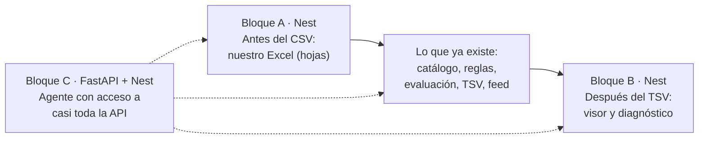

# 02 — Terminar el backend: hojas, después del TSV y agente

Fecha de creación: 2026-11-12  
Última actualización: 2026-11-14  
Estado: En curso. P1, el Bloque B (V2–V5), el Bloque A (H1–H5) y C7 (evaluación e implementación) hechos y verificados (2026-11-14); sigue el Bloque C desde E6.1b.2.  
Ámbito: la API Nest (`LearningAllPosibolIt`) y el servicio de IA (`LearningAllPosibolIt-ai`). La web Nuxt (E7) la lleva otra sesión.  
Relacionada con: [fuentes 04](../../../fonts/feature/cierre-backend/04-fuentes-de-terminar-hojas-visor-y-agente.md), [plan 01 de cierre](01-plan-cierre-de-pendientes.md), [23, plan C7](../../../../../docs-diagrams/23-graphql-nest-para-fastapi-y-nuxt.md), [plan E6](../ai-assistant/01-plan-e6-ia-con-qdrant-y-llamaindex.md), [22](../../../../../docs-diagrams/22-visor-y-diagnostico-del-feed.md), [12](../../../../../docs-diagrams/12-hojas-modelo-editor-importacion-y-exportacion.md), [15](../../../../../docs-diagrams/15-chat-ia-herramientas-y-propuestas.md).  
Revisión de partida: `feature/cierre-backend` `b219b30` más los cambios sin commit de los días 9–11.

## Objetivo

Que el backend cubra el recorrido completo y que el agente lo maneje:

## Quién hace qué

| Parte | Repositorio | Qué le falta |
| --- | --- | --- |
| **Bloque A — hojas** | Nest | Administrar libros y hojas, historial, plantillas de mapeo, vistas guardadas, abrir un catálogo como hoja y las herramientas de hoja que usará el agente |
| **Bloque B — después del TSV** | Nest | Ficha de producto, estado de la entrega, «Requiere atención», comparar TSV y probar reglas |
| **Bloque C — agente** | Nest | Mandar el conocimiento, conversaciones, catálogo de operaciones, ejecuciones, confirmaciones, eventos SSE y cuotas |
| | FastAPI | Agente de LlamaIndex, selección de herramientas, espera de confirmación, streaming, modelo Gemini y evaluación |

Regla del reparto (plan E6): **Nest decide y calcula; FastAPI razona.** Todo lo que toca datos, permisos o valores exactos es de Nest, también cuando lo pide el agente.

## Decisiones

| ID | Decisión | Respaldo |
| --- | --- | --- |
| P1 | **Orden vigente:** Evaluación C7 → V5 → H1–H5 → implementación y verificación de C7 → Bloque C desde E6.1b.2. El piloto de C7 parte del código actual. Su alcance final incluye las operaciones reales de V5 y H1–H5 antes de retomar el agente. | Fuentes 04: E1, E4 |
| P2 | **Ficha de producto por ID** leyendo el mismo TSV: `GET …/exports/:exportId/product?id=…` y `GET …/feeds/:feedId/versions/:versionId/product?id=…`. Devuelve columnas, valores, línea y procedencia (exportación o versión, evaluación de origen y fecha). 404 `PRODUCT_NOT_FOUND` si no está en ese archivo. *Ajustado en V2:* el `id` va en la consulta y no en la ruta, porque un SKU puede llevar barras y otros signos. | H3; E4 |
| P3 | **Estado de la entrega:** `GET …/feeds/:feedId/delivery` responde si la URL pública entrega y, si no, el motivo (`no_published_version`, `delivery_disabled`, `file_unavailable`). No expone el token. *Ajustado en V2:* el tercer motivo es `file_unavailable` (falta el archivo de la versión publicada); la retención nunca retira el de la versión vigente, así que «retirado» no puede ocurrir aquí. | H7; E4 |
| P4 | **«Requiere atención»:** `GET …/evaluations/:evaluationId/attention` agrupa en SQL por problema y atributo, cuenta productos distintos por grupo, da el total de afectados sin repetir y las exclusiones por regla aparte. `GET …/evaluations/:id/rows` gana filtros `problem`, `field` y `rule` para abrir un grupo. | H4; E4 |
| P5 | **Comparar con el feed vigente:** `GET …/feeds/:feedId/comparison?exportId=…` compara por `id` el TSV candidato con el de la versión publicada: recuentos de añadidos, retirados, modificados e iguales y una página de cambios con los campos que cambiaron. Se leen los dos archivos en memoria (límite ya existente de filas por catálogo). *Ajustado en V4:* sin versión publicada, 409 `FEED_NOT_PUBLISHED`; si falta un archivo, el 503 que ya daba el visor. | H5 |
| P6 | **Probar reglas sin publicar:** `POST …/rulesets/preview` recibe un catálogo y unas reglas propuestas, pasa el **mismo motor** por las filas sin guardar nada y lo compara con la revisión vigente: problemas que aparecen, se resuelven o siguen, valores que cambian por atributo y productos afectados. Síncrono y acotado.  *Ajustado en V5:* la ruta es `POST …/evaluations/preview` (es una evaluación que no se guarda y ese módulo es el dueño del motor); pide Editor aunque no escribe. | H6 |
| P7 | **Archivar y renombrar** libros y hojas con `PATCH` y `POST …/archive` / `…/restore`; una hoja archivada se lee pero no admite borradores, importaciones ni puente (409 `WORKSHEET_ARCHIVED`). Columna `archived_at`: migración. | H8; E2 |
| P8 | **Duplicar una hoja** fija la revisión de origen, crea hoja, columnas y filas con IDs nuevos y guarda la procedencia; no copia borradores. | H8 |
| P9 | **Historial:** listados paginados de revisiones, borradores, importaciones y exportaciones de una hoja. Solo lectura, sin migración. | E2 |
| P10 | **Plantillas de mapeo** (`worksheet_import_mappings`) y **vistas guardadas** (`worksheet_saved_views`, personales o del equipo), validadas contra el esquema de la hoja al guardar y al usar. *Ajustado en H3 y H4:* la plantilla guarda solo lo que no depende del archivo (modo, clave, separador decimal, booleanos y columnas) y sirve para CSV y XLSX; se usa con el campo `mappingId`. Las vistas se usan con `viewId` en `rows/query`; una personal solo existe para su autor y una del equipo la crea un Editor (valor por defecto de la decisión abierta). | H9 |
| P11 | **Catálogo → hoja:** `POST …/workbooks/:workbookId/worksheets/from-catalog` crea una hoja nueva con las columnas y filas de un snapshot terminado, por el mismo camino que una importación (límite de 5.000 filas). *Ajustado en H5:* no pasa por un borrador: abrir un catálogo crea una hoja nueva, como crearla vacía o duplicarla; toma de la importación los límites y la forma de los errores. Vive en el módulo puente (`worksheet-catalog-snapshots`). | 12, vínculo inverso |
| P12 | **Herramientas de hoja para el agente en Nest:** `preview_transform` (operación cerrada: limpiar espacios, reemplazo exacto, porcentaje, mapa de valores), `create_change_proposal` (crea el changeset desde una vista previa vigente) y `propose_sheet_layout`. Son rutas normales con DTO; el catálogo las declara como cualquier otra. | H2; 15 |
| P13 | **Cobertura comprobada del catálogo:** una prueba recorre las rutas reales de la aplicación y falla si alguna no está declarada en el catálogo ni en la lista de exclusiones con motivo. Así «casi toda la API» no depende de la memoria de nadie. | H1; E1 |
| P14 | **C7 se evalúa primero y se implementa antes del Bloque C.** Inventario y piloto REST/GraphQL. El 70–85 % orienta la evaluación. Construir las operaciones justificadas para FastAPI y Nuxt, verificar el cliente Python con Nest y retomar E6.1b.2. | [23, plan C7](../../../../../docs-diagrams/23-graphql-nest-para-fastapi-y-nuxt.md) |

## Etapas

Cada etapa sigue el flujo: ficha de fuentes si hay un mecanismo nuevo, bitácora «En curso», código, pruebas (unitarias, integración PGlite, E2E con dos organizaciones y roles), defectos a propósito, verificación completa y cierre.

### Paso 0 — Cerrar lo empezado

| Etapa | Repositorio | Qué | Comprobación |
| --- | --- | --- | --- |
| ✅ **P1 · E6.1b.1** | Nest | E2E del conocimiento, defectos y verificación ([bitácora](../../../../bitacora-construccion/feature/ai-assistant/02-nest-manda-el-conocimiento.md)) | Hecho el 2026-11-12: 37 pruebas, 15 de 15 defectos, arranque real |

### Bloque B — Después del TSV (Nest)

| Etapa | Qué | Comprobación |
| --- | --- | --- |
| ✅ **V2** | Ficha de producto y estado de la entrega (P2, P3), [bitácora 03](../../../../bitacora-construccion/feature/ai-assistant/03-ficha-de-producto-y-estado-de-la-entrega.md) | Hecho el 2026-11-12: 40 pruebas del visor, 14 de 14 defectos |
| ✅ **V3** | «Requiere atención» y filtros de filas (P4), [bitácora 04](../../../../bitacora-construccion/feature/ai-assistant/04-requiere-atencion.md) | Hecho el 2026-11-12: 16 pruebas nuevas; 15 defectos (13 por pruebas, 1 por el compilador, 1 equivalente) |
| ✅ **V4** | Comparar candidato y vigente (P5), [bitácora 05](../../../../bitacora-construccion/feature/ai-assistant/05-comparar-con-la-version-vigente.md) | Hecho el 2026-11-12: 16 pruebas nuevas, 13 de 13 defectos |
| ✅ **V5** | Probar reglas (P6), [bitácora 06](../../../../bitacora-construccion/feature/ai-assistant/06-probar-reglas-sin-publicar.md) | Hecho el 2026-11-13: 30 pruebas, 20 de 20 defectos (19 por pruebas, 1 por el compilador) |

### Bloque A — Antes del CSV: hojas (Nest)

| Etapa | Qué | Comprobación |
| --- | --- | --- |
| ✅ **H1** | Renombrar, archivar, restaurar y duplicar (P7, P8). Migración 32, [bitácora 04](../../../../bitacora-construccion/feature/worksheets/04-renombrar-archivar-y-duplicar.md) | Hecho el 2026-11-14: 31 pruebas, 20 de 20 defectos |
| ✅ **H2** | Historial: revisiones, borradores, importaciones y exportaciones (P9), [bitácora 05](../../../../bitacora-construccion/feature/worksheets/05-historial-de-la-hoja.md) | Hecho el 2026-11-14: 10 pruebas, 14 de 14 defectos |
| ✅ **H3** | Plantillas de mapeo (P10). Migración 33, [bitácora 06](../../../../bitacora-construccion/feature/worksheets/06-plantillas-de-mapeo.md) | Hecho el 2026-11-14: 24 pruebas, 14 de 14 defectos |
| ✅ **H4** | Vistas guardadas (P10). Migración 34, [bitácora 07](../../../../bitacora-construccion/feature/worksheets/07-vistas-guardadas.md) | Hecho el 2026-11-14: 15 pruebas, 12 de 12 defectos |
| ✅ **H5** | Catálogo → hoja (P11). Migración 35, [bitácora 08](../../../../bitacora-construccion/feature/worksheets/08-abrir-un-catalogo-como-hoja.md) | Hecho el 2026-11-14: 13 pruebas, 12 de 12 defectos; exportada y de vuelta al catálogo, igual |

### C7 — GraphQL de Nest para FastAPI y Nuxt

Evaluar primero toda la API con el inventario y el piloto del [23, plan C7](../../../../../docs-diagrams/23-graphql-nest-para-fastapi-y-nuxt.md). Tras V5 y H1–H5, implementar el alcance justificado y completar la verificación del cliente Python contra Nest antes de retomar E6.1b.2.

### Bloque C — Agente (FastAPI + Nest)

| Etapa | Repositorio | Qué | Comprobación |
| --- | --- | --- | --- |
| **E6.1b.2** | Nest | Fuentes de hojas y organización en el índice | Las cinco fuentes nuevas; sin correos |
| **E6.2** | Nest | Conversaciones y mensajes. Migración | Privadas; `clientMessageId` idempotente |
| **H6** | Nest | Herramientas de hoja para el agente (P12) | 5 % exacto sobre la selección; solo crea un borrador (T20) |
| **E6.3a** | Nest | Catálogo de operaciones, autorización del cliente GraphQL con token por ejecución y ruta interna para las demás operaciones autorizadas, ejecuciones y confirmaciones (P13) | Cobertura de rutas; nada prohibido declarado; ajeno 404 |
| **E6.3b** | FastAPI | `FunctionAgent` con LLM simulado, herramientas por búsqueda y espera de confirmación | T18, T19 |
| **E6.4** | Los dos | Streaming, SSE con `after=<seq>`, cancelar y cuotas | T21, T22 |
| **E6.5** | FastAPI | Gemini por Vertex AI con evaluación | Dataset de 15; coste medido |
| **E6.6** | Los dos | Endurecimiento, contrato para Nuxt y plan de despliegue | Recorrido completo con dos organizaciones; IA apagada |
| **E6.7** | FastAPI | (Opcional) servidor MCP | Si el usuario lo pide |

## Orden de ejecución

Completados: P1, V2, V3, V4, V5 y la **evaluación de C7** (2026-11-13): matriz de 88 rutas, alcance recomendado de 64 (72,7 %) y piloto medido, en la [ficha 05](../../../fonts/feature/graphql&rulesets-evaluations-exports/05-inventario-y-alcance-de-c7.md) y la [bitácora del piloto](../../../../bitacora-construccion/feature/graphql&rulesets-evaluations-exports/01-piloto-de-c7-y-mediciones.md).

Completado además el 2026-11-14: H1–H5 (Bloque A) y la **implementación de C7**: 85 de 109 rutas con equivalente GraphQL, cliente Python contra Nest y contrato para Nuxt ([plan 02 de C7](../graphql&rulesets-evaluations-exports/02-plan-c7-implementar-graphql.md), bitácoras 02–06 de `graphql&rulesets-evaluations-exports`).

Pendientes: Bloque C desde E6.1b.2 → E6.2 → H6 → E6.3a → E6.3b → E6.4 → E6.5 → E6.6.

## Comprobación al cerrar el plan

Recorrido completo con dos organizaciones y los dos servicios arrancados: crear una hoja, importar un XLSX, aplicar el borrador, pasarla al catálogo, evaluar, ver «Requiere atención», comparar con el feed vigente, publicar, y pedirle al agente una consulta y una propuesta de cambio que solo se aplica con el clic humano. Repetirlo con el servicio de IA apagado: todo lo que no es chat sigue funcionando.

## Límites

- Las pantallas son de la web (E7).
- Productos, inventario, pedidos y canales (E8–E10) no entran.
- No se cambian rutas existentes: solo se añaden.
- Migraciones: se crean y se prueban en local; en Cloud SQL las aplica el usuario.
- Commits: solo cuando el usuario los pida.

## Decisiones que quedan para el usuario (no bloquean el arranque)

- Si las vistas guardadas del equipo las puede crear un Editor o solo un Manager (por defecto: Editor).
- Flash o Pro para el chat (E6.5) y cuándo activar el envío de datos reales a Google.
- Si quiere el servidor MCP (E6.7).
