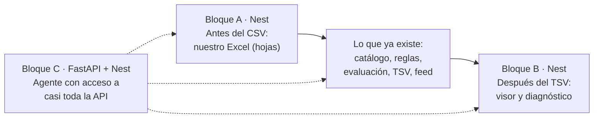

# 02 — Terminar el backend: hojas, después del TSV y agente

Fecha de creación: 2026-11-12  
Última actualización: 2026-11-12  
Estado: En curso. P1, V2, V3 y V4 hechas y verificadas (2026-11-12); sigue V5.  
Ámbito: la API Nest (`claudeLearningAllPosibolIt`) y el servicio de IA (`claudeLearningAllPosibolIt-ai`). La web Nuxt (E7) la lleva otra sesión.  
Relacionada con: [fuentes 04](../../../fonts/feature/cierre-backend/04-fuentes-de-terminar-hojas-visor-y-agente.md), [plan 01 de cierre](01-plan-cierre-de-pendientes.md) (C7 sigue ahí), [plan E6](../ai-assistant/01-plan-e6-ia-con-qdrant-y-llamaindex.md) (decisiones D1–D18, que este plan no cambia), [22](../../../../../docs-diagrams/22-visor-y-diagnostico-del-feed.md), [12](../../../../../docs-diagrams/12-hojas-modelo-editor-importacion-y-exportacion.md), [15](../../../../../docs-diagrams/15-chat-ia-herramientas-y-propuestas.md).  
Revisión de partida: `feature/cierre-backend` `b219b30` más los cambios sin commit de los días 9–11.

## Objetivo

Que el backend cubra el recorrido completo y que el agente lo maneje:

## Quién hace qué

| Parte | Repositorio | Qué le falta |
| --- | --- | --- |
| **Bloque A — hojas** | Nest | Administrar libros y hojas, historial, plantillas de mapeo, vistas guardadas, abrir un catálogo como hoja y las herramientas de hoja que usará el agente |
| **Bloque B — después del TSV** | Nest | Ficha de producto, estado de la entrega, «Requiere atención», comparar TSV y probar reglas |
| **Bloque C — agente** | Nest | Mandar el conocimiento, conversaciones, catálogo de operaciones, ejecuciones, confirmaciones, eventos SSE y cuotas |
| | FastAPI | Agente de LlamaIndex, selección de herramientas, espera de confirmación, streaming, modelo Gemini y evaluación |

Regla del reparto (plan E6): **Nest decide y calcula; FastAPI razona.** Todo lo que toca datos, permisos o valores exactos es de Nest, también cuando lo pide el agente.

## Decisiones

| ID | Decisión | Respaldo |
| --- | --- | --- |
| P1 | **Orden: cerrar lo empezado → Bloque B → Bloque A → Bloque C.** B y A van antes del agente porque el catálogo de operaciones y el índice tienen que incluirlos; hacerlos después obligaría a tocar el agente dos veces. B antes que A porque son lecturas sin migración sobre archivos que ya existen. | Fuentes 04: E1, E4 |
| P2 | **Ficha de producto por ID** leyendo el mismo TSV: `GET …/exports/:exportId/product?id=…` y `GET …/feeds/:feedId/versions/:versionId/product?id=…`. Devuelve columnas, valores, línea y procedencia (exportación o versión, evaluación de origen y fecha). 404 `PRODUCT_NOT_FOUND` si no está en ese archivo. *Ajustado en V2:* el `id` va en la consulta y no en la ruta, porque un SKU puede llevar barras y otros signos. | H3; E4 |
| P3 | **Estado de la entrega:** `GET …/feeds/:feedId/delivery` responde si la URL pública entrega y, si no, el motivo (`no_published_version`, `delivery_disabled`, `file_unavailable`). No expone el token. *Ajustado en V2:* el tercer motivo es `file_unavailable` (falta el archivo de la versión publicada); la retención nunca retira el de la versión vigente, así que «retirado» no puede ocurrir aquí. | H7; E4 |
| P4 | **«Requiere atención»:** `GET …/evaluations/:evaluationId/attention` agrupa en SQL por problema y atributo, cuenta productos distintos por grupo, da el total de afectados sin repetir y las exclusiones por regla aparte. `GET …/evaluations/:id/rows` gana filtros `problem`, `field` y `rule` para abrir un grupo. | H4; E4 |
| P5 | **Comparar con el feed vigente:** `GET …/feeds/:feedId/comparison?exportId=…` compara por `id` el TSV candidato con el de la versión publicada: recuentos de añadidos, retirados, modificados e iguales y una página de cambios con los campos que cambiaron. Se leen los dos archivos en memoria (límite ya existente de filas por catálogo). *Ajustado en V4:* sin versión publicada, 409 `FEED_NOT_PUBLISHED`; si falta un archivo, el 503 que ya daba el visor. | H5 |
| P6 | **Probar reglas sin publicar:** `POST …/rulesets/preview` recibe un catálogo y unas reglas propuestas, pasa el **mismo motor** por las filas sin guardar nada y lo compara con la revisión vigente: problemas que aparecen, se resuelven o siguen, valores que cambian por atributo y productos afectados. Síncrono y acotado. | H6 |
| P7 | **Archivar y renombrar** libros y hojas con `PATCH` y `POST …/archive` / `…/restore`; una hoja archivada se lee pero no admite borradores, importaciones ni puente (409 `WORKSHEET_ARCHIVED`). Columna `archived_at`: migración. | H8; E2 |
| P8 | **Duplicar una hoja** fija la revisión de origen, crea hoja, columnas y filas con IDs nuevos y guarda la procedencia; no copia borradores. | H8 |
| P9 | **Historial:** listados paginados de revisiones, borradores, importaciones y exportaciones de una hoja. Solo lectura, sin migración. | E2 |
| P10 | **Plantillas de mapeo** (`worksheet_import_mappings`) y **vistas guardadas** (`worksheet_saved_views`, personales o del equipo), validadas contra el esquema de la hoja al guardar y al usar. | H9 |
| P11 | **Catálogo → hoja:** `POST …/workbooks/:workbookId/worksheets/from-catalog` crea una hoja nueva con las columnas y filas de un snapshot terminado, por el mismo camino que una importación (límite de 5.000 filas). | 12, vínculo inverso |
| P12 | **Herramientas de hoja para el agente en Nest:** `preview_transform` (operación cerrada: limpiar espacios, reemplazo exacto, porcentaje, mapa de valores), `create_change_proposal` (crea el changeset desde una vista previa vigente) y `propose_sheet_layout`. Son rutas normales con DTO; el catálogo las declara como cualquier otra. | H2; 15 |
| P13 | **Cobertura comprobada del catálogo:** una prueba recorre las rutas reales de la aplicación y falla si alguna no está declarada en el catálogo ni en la lista de exclusiones con motivo. Así «casi toda la API» no depende de la memoria de nadie. | H1; E1 |
| P14 | **C7 (GraphQL) queda después de este plan**, como estaba. Si el usuario lo quiere antes, se intercala. | Plan 01, P7 |

## Etapas

Cada etapa sigue el flujo: ficha de fuentes si hay un mecanismo nuevo, bitácora «En curso», código, pruebas (unitarias, integración PGlite, E2E con dos organizaciones y roles), defectos a propósito, verificación completa y cierre.

### Paso 0 — Cerrar lo empezado

| Etapa | Repositorio | Qué | Comprobación |
| --- | --- | --- | --- |
| ✅ **P1 · E6.1b.1** | Nest | E2E del conocimiento, defectos y verificación ([bitácora](../../../../bitacora-construccion/feature/ai-assistant/02-nest-manda-el-conocimiento.md)) | Hecho el 2026-11-12: 37 pruebas, 15 de 15 defectos, arranque real |

### Bloque B — Después del TSV (Nest)

| Etapa | Qué | Comprobación |
| --- | --- | --- |
| ✅ **V2** | Ficha de producto y estado de la entrega (P2, P3), [bitácora 03](../../../../bitacora-construccion/feature/ai-assistant/03-ficha-de-producto-y-estado-de-la-entrega.md) | Hecho el 2026-11-12: 40 pruebas del visor, 14 de 14 defectos |
| ✅ **V3** | «Requiere atención» y filtros de filas (P4), [bitácora 04](../../../../bitacora-construccion/feature/ai-assistant/04-requiere-atencion.md) | Hecho el 2026-11-12: 16 pruebas nuevas; 15 defectos (13 por pruebas, 1 por el compilador, 1 equivalente) |
| ✅ **V4** | Comparar candidato y vigente (P5), [bitácora 05](../../../../bitacora-construccion/feature/ai-assistant/05-comparar-con-la-version-vigente.md) | Hecho el 2026-11-12: 16 pruebas nuevas, 13 de 13 defectos |
| **V5** | Probar reglas (P6) | Un valor modificado, un problema resuelto y otro nuevo; nada guardado |

### Bloque A — Antes del CSV: hojas (Nest)

| Etapa | Qué | Comprobación |
| --- | --- | --- |
| **H1** | Renombrar, archivar, restaurar y duplicar (P7, P8). Migración | Archivada: lectura sí, escritura 409; duplicado con IDs nuevos |
| **H2** | Historial: revisiones, borradores, importaciones y exportaciones (P9) | Paginación, orden y aislamiento |
| **H3** | Plantillas de mapeo (P10). Migración | Guardar, usar en vista previa e importación; columna que ya no existe |
| **H4** | Vistas guardadas (P10). Migración | Personal no visible para otro; del equipo sí; filtro inválido 400 |
| **H5** | Catálogo → hoja (P11) | La hoja nueva exportada equivale al catálogo de origen |

### Bloque C — Agente (FastAPI + Nest)

| Etapa | Repositorio | Qué | Comprobación |
| --- | --- | --- | --- |
| **E6.1b.2** | Nest | Fuentes de hojas y organización en el índice | Las cinco fuentes nuevas; sin correos |
| **E6.2** | Nest | Conversaciones y mensajes. Migración | Privadas; `clientMessageId` idempotente |
| **H6** | Nest | Herramientas de hoja para el agente (P12) | 5 % exacto sobre la selección; solo crea un borrador (T20) |
| **E6.3a** | Nest | Catálogo de operaciones, ruta interna con token por ejecución, ejecuciones y confirmaciones (P13) | Cobertura de rutas; nada prohibido declarado; ajeno 404 |
| **E6.3b** | FastAPI | `FunctionAgent` con LLM simulado, herramientas por búsqueda y espera de confirmación | T18, T19 |
| **E6.4** | Los dos | Streaming, SSE con `after=<seq>`, cancelar y cuotas | T21, T22 |
| **E6.5** | FastAPI | Gemini por Vertex AI con evaluación | Dataset de 15; coste medido |
| **E6.6** | Los dos | Endurecimiento, contrato para Nuxt y plan de despliegue | Recorrido completo con dos organizaciones; IA apagada |
| **E6.7** | FastAPI | (Opcional) servidor MCP | Si el usuario lo pide |

## Orden de ejecución

P1 → V2 → V3 → V4 → V5 → H1 → H2 → H3 → H4 → H5 → E6.1b.2 → E6.2 → H6 → E6.3a → E6.3b → E6.4 → E6.5 → E6.6. Después, C7.

## Comprobación al cerrar el plan

Recorrido completo con dos organizaciones y los dos servicios arrancados: crear una hoja, importar un XLSX, aplicar el borrador, pasarla al catálogo, evaluar, ver «Requiere atención», comparar con el feed vigente, publicar, y pedirle al agente una consulta y una propuesta de cambio que solo se aplica con el clic humano. Repetirlo con el servicio de IA apagado: todo lo que no es chat sigue funcionando.

## Límites

- Las pantallas son de la web (E7).
- Productos, inventario, pedidos y canales (E8–E10) no entran.
- No se cambian rutas existentes: solo se añaden.
- Migraciones: se crean y se prueban en local; en Cloud SQL las aplica el usuario.
- Commits: solo cuando el usuario los pida.

## Decisiones que quedan para el usuario (no bloquean el arranque)

- Si las vistas guardadas del equipo las puede crear un Editor o solo un Manager (por defecto: Editor).
- Flash o Pro para el chat (E6.5) y cuándo activar el envío de datos reales a Google.
- Si quiere el servidor MCP (E6.7) y si C7 se intercala antes del agente.
