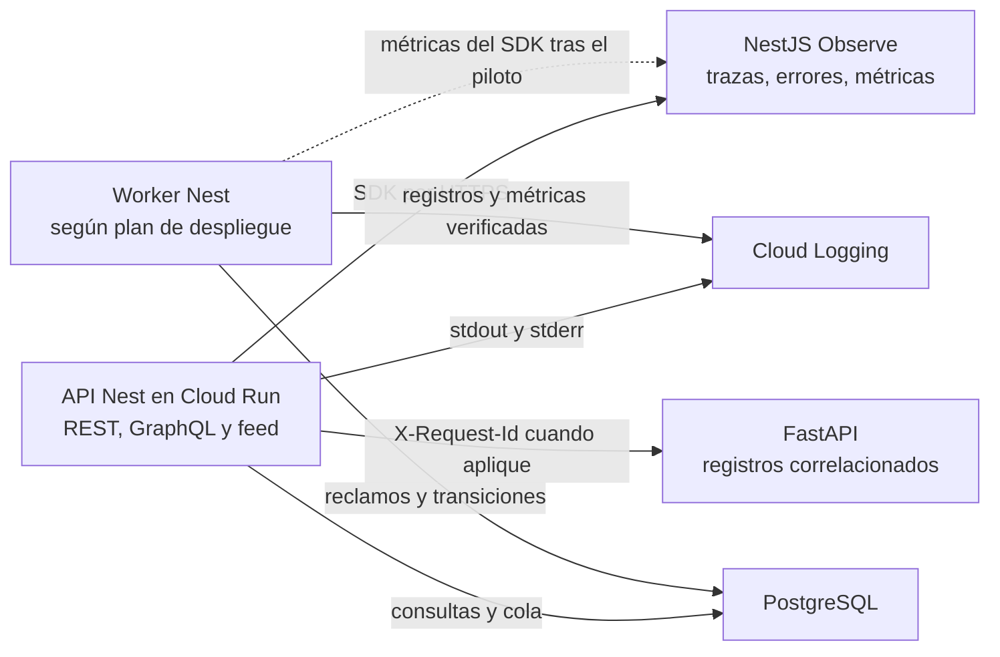

# 01 — Integrar NestJS Observe en la API KTSU

Fecha de creación: 2026-11-13  
Estado: Plan  
Ámbito: procesos NestJS de KTSU  
Revisión de referencia: `3733be48a09be170df92d791a40c5d897e864b9f`, con cambios locales en curso.  
Relacionada con: [SDK y cobertura](../fonts/01-sdk-oficial-y-cobertura.md), [datos y operación](../fonts/02-datos-coste-y-operacion.md), [Google Cloud](../fonts/03-contenedor-google-cloud-y-cursos.md), [decisión inicial](../../bitacora-construccion/01-adoptar-nestjs-observe.md).

## Objetivo

Usar **NestJS Observe** como APM de la API para investigar una petición lenta o fallida desde su release, sus trazas y sus registros correlacionados. El SDK viaja en la imagen Docker que ya necesita Nest. El panel vive en la cuenta de Observe. En Google Cloud, Cloud Logging conserva los logs de aplicación y plataforma, y Cloud Monitoring permite vigilar la disponibilidad del servicio. [F1–F2](../fonts/01-sdk-oficial-y-cobertura.md) · [F12–F16](../fonts/03-contenedor-google-cloud-y-cursos.md)



## Punto de partida

- [main.ts](../../../src/main.ts) arranca Nest ESM, activa shutdown hooks y escucha en `127.0.0.1`. El [plan de imagen](../../../../deploys/docs/plans/02-imagenes-y-prueba-local.md) cubre el cambio para exponer `0.0.0.0:$PORT` en Cloud Run. Verificar el comando real y el artefacto de build antes de publicar la imagen.
- [configureHttp](../../../src/configure-http.ts) asigna el ID y normaliza errores REST. [ApiExceptionFilter](../../../src/common/http/api-exception.filter.ts) y [normalizeApolloError](../../../src/graphql/graphql-config.ts) generan IDs independientes en algunos errores GraphQL. Correlacionar ambas vías es un punto explícito de la prueba.
- [HealthController](../../../src/health/health.controller.ts) consulta PostgreSQL. [QueueMonitor](../../../src/health/queue-monitor.ts) avisa si hay trabajo listo que lleva demasiado tiempo esperando. Los workers consumen sus colas PostgreSQL mediante [WorkerLoop](../../../src/jobs/worker-loop.ts).
- [AiServiceClient](../../../src/knowledge/ai-service.client.ts) ya manda `X-Request-Id` a FastAPI, donde [observe_request](../../../../LearningAllPosibolIt-ai/src/ktsu_ai/http/middleware/observability.py) lo registra. El cruce entre servicios se puede investigar por ese ID. La visibilidad del panel Observe se valida sobre los procesos Nest.

## Etapa 1 · Integrar el SDK y demostrar el contrato local

1. Fijar una versión de `@nestjs/observe` como dependencia de runtime con pnpm y revisar sus pares. Tomar una línea base de build y pruebas unitarias/E2E relevantes antes de cambiar bootstrap. Usar una configuración con nombre que permita leer, de arriba abajo, habilitación, credenciales, identidad, captura y apagado.
2. Crear una sola pareja con `createObserveModule()`, importar `ObserveModule.forRoot()` al principio del módulo raíz y pasar `ObserveInstrument` a `NestFactory.create()`. Conservar `configureHttp(app)` y `app.enableShutdownHooks()`. Leer configuración disponible antes de importar el módulo o resolverla con una fábrica compatible con la versión fijada. Mantener `OBSERVE_ENABLED=false` por defecto en local y CI.
3. Probar el servidor compilado con el SDK apagado y repetir las pruebas sensibles al contrato. Comprobar cabecera `X-Request-Id`, JSON mal formado, error 4xx, `/api/v1/health`, ruta pública del feed y un fallo GraphQL dentro de `errors[]`. El criterio es conservar el estado, las cabeceras y la forma pública de la respuesta y comprobar que el modo apagado carece de tráfico a Observe. [F2, F4–F5](../fonts/01-sdk-oficial-y-cobertura.md)

## Etapa 2 · Activar staging y comprobar qué sale del proceso

1. En el [panel de Observe](https://www.observe.nestjs.com/), crear el proyecto de staging y su par de credenciales. Usar un proyecto y credenciales independientes para producción al promover. Registrar un identificador para API y, si se incorpora, otro para el worker. Confirmar en el panel cómo el `serviceId` de la versión fijada agrupa instancias antes de escalar.
2. Configurar la revisión de staging con las referencias de Secret Manager. Usar dataset sintético y la captura mínima de la ficha [F7–F8](../fonts/02-datos-coste-y-operacion.md). Excluir la ruta con token del feed antes de habilitar Observe sobre tráfico real. Verificar el matcher con la URL efectiva, incluidos prefijos y parámetros. Probar `pg` y HTTP saliente primero con datos sintéticos y activar cada señal por separado tras revisar lo que conserva.
3. Generar una petición REST exitosa, una lenta, un 4xx esperado, un 5xx sintético, una consulta GraphQL nombrada, un error de resolver y un error anterior al resolver. Buscar operación, tiempo, error, versión y traza en el panel. Comprobar con y sin `X-Request-Id` entrante cuál es el ID del cliente, el del SDK y el que aparece en Cloud Logging. Si son distintos, registrar la relación únicamente en el contexto de diagnóstico. En GraphQL, comprobar la relación con el ID devuelto y ajustar el contexto del filtro o del formateador solo si la prueba muestra que hace falta.
4. Enviar marcadores ficticios en credenciales, ruta, query, cuerpo, variables, error y registro. Revisar el panel, los registros de acceso y los de aplicación. Documentar las rutas que requieran exclusión o una representación sanitizada, incluidas rutas salientes a FastAPI y mensajes Prisma/Apollo. Repetir hasta que los marcadores sensibles queden fuera de los destinos. La localización de datos declarada por Nest es AWS `us-east-1`. [F3–F5](../fonts/01-sdk-oficial-y-cobertura.md) · [F7–F10](../fonts/02-datos-coste-y-operacion.md)

## Etapa 3 · Operar el contenedor y las colas

1. Desde una revisión de staging, probar denegación de salida HTTPS, rechazo por credenciales de prueba y apagado con `SIGTERM`. Verificar que la API conserva su comportamiento ante un fallo de exportación, que los buffers y la memoria siguen acotados, y que la revisión termina dentro de la ventana permitida. Verificar también el envío tras una petición aislada para detectar efectos de la CPU entre peticiones.
2. Conservar `/api/v1/health` para disponibilidad dependiente de PostgreSQL y probarlo con un chequeo de disponibilidad de Cloud Monitoring según el acceso del despliegue. Si se añade liveness, usar un chequeo de proceso que permita distinguir un bloqueo local de una caída de PostgreSQL o del SaaS. Excluir probes de las métricas de tráfico de negocio y darles su alerta propia. [F19 · Chequeos de disponibilidad](../fonts/03-contenedor-google-cloud-y-cursos.md)
3. Establecer un solo emisor lógico para las métricas globales de colas, o definir la agregación que evite sumar el backlog varias veces. Mantener transiciones estructuradas por cola, resultado, intento y duración. Medir profundidad de trabajo listo en todos los estados de carga y edad del más antiguo, aprovechando la consulta de `QueueMonitor` y su umbral para alertas. Verificar con un job exitoso, otro que reintenta, uno agotado y un worker reiniciado. Si hace falta más trazabilidad, comprobar primero una API documentada de la versión fijada para abrir contexto de job propio. [F4–F5](../fonts/01-sdk-oficial-y-cobertura.md) · [F13, F15–F16](../fonts/03-contenedor-google-cloud-y-cursos.md)

### Configuración de runtime propuesta

| Variable | Origen | Uso |
| --- | --- | --- |
| `OBSERVE_ENABLED` | Configuración de cada revisión | Interruptor de KTSU. Desactivado por defecto. Habilitarlo requiere que el despliegue haya validado ambos secretos. |
| `OBSERVE_APP_KEY`, `OBSERVE_APP_SECRET` | Variables documentadas por el SDK, inyectadas desde Secret Manager | Par distinto por entorno. Acceso mínimo por identidad de ejecución y versión explícita. |
| `OBSERVE_SERVICE_ID` | Configuración de KTSU leída para `serviceId` | Identidad de la carga Nest. Validar agrupación y distinguir API y worker. |
| `OBSERVE_SERVICE_VERSION` | Release de CI/CD, leído por el SDK | SHA del commit desplegado. Relacionarlo en el pipeline con el digest de imagen y la revisión de Cloud Run. |
| `PORT` | Cloud Run | Puerto HTTP del contenedor de API. |

Para el Cloud Run Service, gestionar el par en **Secret Manager** y referenciar ambas versiones en **Cloud Run → servicio → Editar y desplegar nueva revisión → Variables y secretos**. En el flujo de despliegue con CLI, usar referencias por ejemplo `--update-secrets=OBSERVE_APP_KEY=observe-staging-key:1,OBSERVE_APP_SECRET=observe-staging-secret:1` y la identidad de ejecución con acceso a esos secretos. Los nombres y versiones del ejemplo son ilustrativos. Mantener la configuración reproducible en el IaC de [deploys](../../../../deploys/docs/plans/01-plan-despliegue-en-google-cloud.md). En GKE, usar la identidad del workload y la integración de Secret Manager elegida antes de arrancar Nest. [F14 · Google Cloud](../fonts/03-contenedor-google-cloud-y-cursos.md)

### Verificación desde Google Cloud

Con proyecto, región y nombre de staging definidos en el entorno, consultar el servicio y su salida:

```bash
gcloud run services describe "$NEST_SERVICE" \
  --project "$GCP_PROJECT" --region "$GCP_REGION" \
  --format='value(status.latestReadyRevisionName)'

gcloud run services logs read "$NEST_SERVICE" \
  --project "$GCP_PROJECT" --region "$GCP_REGION" --limit 30
```

En la consola, abrir **Cloud Run → servicio o Worker Pool → Logs**, o **Logging → Logs Explorer** para filtrar por revisión, código y el ID registrado. En Observe, abrir el proyecto de staging, filtrar por aplicación y release y revisar la traza. [F12 · Logs y CLI](../fonts/03-contenedor-google-cloud-y-cursos.md)

## Etapa 4 · Promover y mantener

- Establecer un tablero operativo con tasa de 5xx, fallos GraphQL, p95 por operación, edad de cola, fallos de job y disponibilidad externa. Tomar una línea base a volumen representativo y definir para cada alerta ventana, umbral, responsable y acción. Convertir objetivos del piloto en SLO tras medirlos y según las capacidades del plan.
- Medir sobrecarga, volumen de eventos, retención, presupuesto y tratamiento de errores ante el muestreo. Medir con y sin SDK sobre la misma imagen/configuración salvo el interruptor. Investigar silencios durante escalado a cero antes de activar alertas de ausencia.
- Promover una revisión de producción con tráfico limitado si el mecanismo de entrega lo permite, comprobar trazas y métricas y verificar que el checkout del SHA corresponde al contenedor. Rotar credenciales creando el par nuevo, publicar una revisión, comprobar recepción y revocar las anteriores tras retirar el tráfico de las revisiones que las usaban. Para revertir, devolver tráfico a una revisión con configuración compatible o desplegar la misma imagen con `OBSERVE_ENABLED=false`. Registrar en bitácora las verificaciones y sus resultados reales. [F9–F11](../fonts/02-datos-coste-y-operacion.md) · [F13–F16](../fonts/03-contenedor-google-cloud-y-cursos.md)
